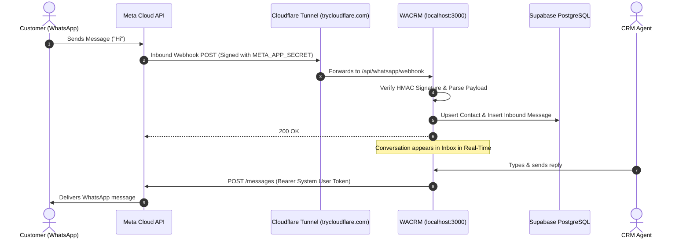

# WACRM Setup Guide & Standard Operating Procedure (SOP)
**End-to-End Configuration for Meta WhatsApp Cloud API & Next.js CRM**

---

## 📌 1. Architecture Overview



---

## 📋 2. Prerequisites Checklist

Before starting, ensure you have:
1. **Node.js**: v20.x or higher installed.
2. **Meta Developer Account**: [developers.facebook.com](https://developers.facebook.com/).
3. **Meta Business Portfolio**: [business.facebook.com](https://business.facebook.com/).
4. **Supabase Account**: [supabase.com](https://supabase.com/) (Free tier works great).

---

## 🔑 3. Supabase Database & Auth Setup

### Step 3.1: Create Project
1. Log in to [Supabase](https://supabase.com/dashboard) and click **"New Project"**.
2. Name your project (e.g. `wacrm-production`) and set a secure database password.

### Step 3.2: Link & Push Migrations
In your local project terminal:
```powershell
# 1. Login to Supabase CLI
npx supabase login

# 2. Link your remote project (replace with your Project Ref)
npx supabase link --project-ref your_supabase_project_ref

# 3. Push schema migrations to the database
npx supabase db push
```

### Step 3.3: Collect API Keys
In your Supabase Dashboard $\rightarrow$ **Project Settings** $\rightarrow$ **API**:
- **Project URL**: `https://xxxxxxxxxxxxxxxxxxxx.supabase.co`
- **anon / public key**: `eyJhbGciOi...`
- **service_role secret**: `eyJhbGciOi...`

---

## 🌐 4. Meta Developer Portal & WhatsApp Business API Setup

### Step 4.1: Create a Meta App
1. Go to **[Meta for Developers](https://developers.facebook.com/apps)** $\rightarrow$ **Create App**.
2. **Use Case**: Select **"Other"** $\rightarrow$ Next $\rightarrow$ Select **"Business"** type.
3. Name your App (e.g., `CRM-Integration-App`) and link it to your Meta Business Account.

### Step 4.2: Add WhatsApp Product
1. From the App Dashboard, find **WhatsApp** and click **"Set up"**.
2. Navigate to **WhatsApp $\rightarrow$ API Setup** on the left menu.
3. Record the following values:
   - **Phone Number ID**: (e.g., `1234567890123456`)
   - **WhatsApp Business Account ID**: (e.g., `9876543210987654`)

### Step 4.3: Get the Meta App Secret
1. Go to **App settings $\rightarrow$ Basic** in the left sidebar.
2. Under **App secret**, click **"Show"** (enter your Facebook password if prompted).
3. Copy the Secret string (e.g., `a1b2c3d4e5f67890abcdef1234567890`).

```
┌─────────────────────────────────────────────────────────────┐
│ Meta App Settings > Basic                                    │
├─────────────────────────────────────────────────────────────┤
│ App ID:        1122334455667788                             │
│ App secret:    ••••••••••••••••••••••••••••••••  [Show]     │
└─────────────────────────────────────────────────────────────┘
```

---

## 🛡️ 5. Generate Permanent System User Access Token

> [!IMPORTANT]
> **Never use Temporary Access Tokens for production.** They expire after 24 hours. Follow these steps to generate a permanent token that never expires.

### Step 5.1: Create System User
1. Go to **[Meta Business Suite Settings](https://business.facebook.com/settings)**.
2. In the left sidebar under **Users**, click **System users**.
3. Click **"Add"**:
   - **System username**: `CRM Integrator` *(Do not use "Admin" or "Meta" in the name)*
   - **System user role**: `Admin`
   - Click **Create system user**.

### Step 5.2: Assign App & WhatsApp Assets
1. In the left menu under **Accounts**, click **Apps**:
   - Select your App $\rightarrow$ Click **Assign people / system users**.
   - Select `CRM Integrator` $\rightarrow$ Toggle **Full control (Manage app)** $\rightarrow$ **Save**.
2. In the left menu under **Accounts**, click **WhatsApp accounts**:
   - Select your WhatsApp account $\rightarrow$ Click **Assign people / system users**.
   - Select `CRM Integrator` $\rightarrow$ Toggle **Full control** $\rightarrow$ **Save**.

### Step 5.3: Generate Permanent Token
1. Go back to **Users $\rightarrow$ System users** $\rightarrow$ Select `CRM Integrator`.
2. Click **"Generate token"**:
   - **Select app**: Choose your CRM App.
   - **Token expiration**: Select **Never** (or 60 days).
   - **Permissions**: Check:
     - ☑️ `whatsapp_business_messaging`
     - ☑️ `whatsapp_business_management`
3. Click **Generate token** and copy the resulting string (`EAA...`).

```
┌─────────────────────────────────────────────────────────────┐
│ Meta Business Suite > Users > System users                  │
├─────────────────────────────────────────────────────────────┤
│ System User:  CRM Integrator (Admin)                        │
│ Assets:       CRM-Integration-App (Full Control)            │
│               WhatsApp Account (Full Control)               │
│ Permissions:  whatsapp_business_messaging                  │
│               whatsapp_business_management                 │
│ Expiration:   Never                                         │
│ Token:        EAAxxxxxxxxxxxxxxxxxxxxxxxxxxxxxxxxxxxx       │
└─────────────────────────────────────────────────────────────┘
```

---

## ⚙️ 6. Local Environment Configuration (`.env.local`)

In the project root folder, create or update `.env.local`:

```env
# -------------------------------------------------------------
# Supabase Configuration (From Supabase Project Settings > API)
# -------------------------------------------------------------
NEXT_PUBLIC_SUPABASE_URL=https://your_project_ref.supabase.co
NEXT_PUBLIC_SUPABASE_ANON_KEY=eyJhbGciOiJIUzI1NiIsInR5cCI6IkpXVCJ9...
SUPABASE_SERVICE_ROLE_KEY=eyJhbGciOiJIUzI1NiIsInR5cCI6IkpXVCJ9...

# -------------------------------------------------------------
# Encryption Key for sensitive tokens (64 hex characters)
# Generate with: node -e "console.log(require('crypto').randomBytes(32).toString('hex'))"
# -------------------------------------------------------------
ENCRYPTION_KEY=0123456789abcdef0123456789abcdef0123456789abcdef0123456789abcdef

# -------------------------------------------------------------
# Meta App Secret (From Meta Developers > App Settings > Basic)
# Required for verifying webhook HMAC-SHA256 signatures
# -------------------------------------------------------------
META_APP_SECRET=a1b2c3d4e5f67890abcdef1234567890

# -------------------------------------------------------------
# Application Settings
# -------------------------------------------------------------
NEXT_PUBLIC_SITE_URL=http://localhost:3000
NEXT_PUBLIC_APP_LOCALE=en
WHATSAPP_TEMPLATES_DRY_RUN=false
```

---

## 🚀 7. One-Click Startup Script (`start-dev.bat`)

To start both the **Next.js Dev Server** and the **Cloudflare Public Tunnel** in one click:

Double-click **`start-dev.bat`** (or run in terminal):
```powershell
.\start-dev.bat
```

What this does automatically:
1. Starts `npm run dev` on `http://localhost:3000`.
2. Starts `npx -y cloudflared tunnel --url http://127.0.0.1:3000`.
3. Opens your browser directly to `http://localhost:3000`.

---

## 🔗 8. Webhook Configuration in Meta

In the Cloudflare terminal window, locate your public tunnel URL:
```text
https://your-tunnel-subdomain.trycloudflare.com
```

### In Meta Developer Portal:
1. Go to **WhatsApp $\rightarrow$ Configuration**.
2. In the **Webhook** section, click **Edit**:
   - **Callback URL**: `https://your-tunnel-subdomain.trycloudflare.com/api/whatsapp/webhook`
   - **Verify token**: `my_secret_token` *(or your custom verify string)*
3. Click **"Verify and save"**.
4. In the **Webhook fields** table below, find **`messages`** and ensure it is **Subscribed**.

```
┌─────────────────────────────────────────────────────────────┐
│ Meta WhatsApp > Configuration > Webhook                     │
├─────────────────────────────────────────────────────────────┤
│ Callback URL: https://xxxx.trycloudflare.com/api/whatsapp/webhook │
│ Verify token: my_secret_token                               │
│                                                             │
│ Subscribed Fields:                                          │
│ [x] messages (v26.0)                                        │
└─────────────────────────────────────────────────────────────┘
```

---

## 🖥️ 9. In-App CRM Setup (WACRM UI)

### Step 9.1: Save WhatsApp Credentials
1. Navigate to: **[http://localhost:3000/settings?tab=whatsapp](http://localhost:3000/settings?tab=whatsapp)**.
2. Enter:
   - **Phone Number ID**: `1234567890123456`
   - **WhatsApp Business Account ID**: `9876543210987654`
   - **Permanent Access Token**: `EAA...` *(System User Token)*
   - **Webhook Verify Token**: `my_secret_token`
   - **Two-Step PIN**: *(Leave blank for Sandbox numbers, or enter 6-digit PIN for production numbers)*
3. Click **"Save Configuration"**.
4. Both badges will turn active:
   - `✓ Credentials valid`
   - `✓ Registered — Meta will deliver events to wacrm`

### Step 9.2: Sync WhatsApp Templates
1. In the sidebar under **WORKSPACE**, click **Templates**.
2. Click **"Sync with Meta"** (🔄).
3. The pre-approved `hello_world` template will appear.

---

## 💬 10. Testing Live 2-Way Messaging

### Step 10.1: Whitelist Recipient Number *(Meta Sandbox only)*
In Meta Developer Portal $\rightarrow$ **WhatsApp $\rightarrow$ API Setup**:
- Under the **"To"** dropdown, add and verify your personal mobile number (e.g., `+91 98765 43210`).

### Step 10.2: Initiate Conversation
1. In WACRM, go to **Contacts** $\rightarrow$ Click **+ Add Contact**.
2. Enter your Name and personal WhatsApp phone number $\rightarrow$ **Save**.
3. Click on the contact $\rightarrow$ Click **"Send Template"** $\rightarrow$ Choose `hello_world` $\rightarrow$ **Send**.

### Step 10.3: Reply & Chat
1. Open WhatsApp on your phone and reply to the received template message.
2. Go to **Inbox** in WACRM ([http://localhost:3000/inbox](http://localhost:3000/inbox)).
3. Select your conversation thread.
4. The 24-hour service window will unlock, allowing real-time 2-way messaging!

---

## 🛠️ 11. Troubleshooting Reference

| Symptom | Cause | Solution |
| :--- | :--- | :--- |
| **"Unable to reach origin service / connection refused [::1]:3000"** | Windows tries IPv6 (`localhost`) instead of IPv4 (`127.0.0.1`). | Run tunnel with `http://127.0.0.1:3000`. |
| **"Callback URL couldn't be validated"** | Missing `/api/whatsapp/webhook` or using `localtunnel` which blocks bots. | Use Cloudflare Tunnel (`cloudflared`) and check full path. |
| **"Rejected request with invalid signature"** | `META_APP_SECRET` in `.env.local` is set to placeholder or wrong app. | Copy App Secret from Meta App Settings $\rightarrow$ Basic into `.env.local`. |
| **"24-hour session expired. Use a template"** | WhatsApp policy: business cannot initiate free-text chat without customer reply. | Send a message from the customer's phone to open the 24-hour window. |
| **"Session has expired" (Meta Token)** | Used 24-hour temporary token instead of System User token. | Generate permanent System User token in Business Suite. |

---

*Document version: 1.0.0 | Author: Antigravity AI Engineering*
